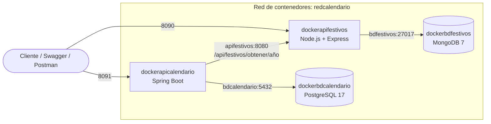

# Orquestación API Calendario + API Festivos — Docker Compose

**Instituto Tecnológico Metropolitano (ITM)** · Arquitectura de Software 2 · Taller 4 (Docker)

## Integrantes

| Nombre | Correo |
|---|---|
| Nathalie Gabriela Miranda Rejón | nathaliemiranda1117738@correo.itm.edu.co |
| Samuel Quiroz Rincón | samuelquiroz1113937@correo.itm.edu.co |
| Sebastián Jesús Pérez Araujo | sebastianperez1116036@correo.itm.edu.co |
| Kevin Daniel Mendoza Castillo | kevinmendoza1111192@correo.itm.edu.co |

## Arquitectura de la solución

Cuatro contenedores en la red `redcalendario` (driver `bridge`). Dentro de la red los servicios se
encuentran por su nombre de servicio.



| Servicio | Contenedor | Origen | Puerto host → contenedor | Volumen |
|---|---|---|---|---|
| `bdfestivos` | `dockerbdfestivos` | imagen `mongo:7` + `bdFestivos/iniciarBDFestivos.js` | 27018 → 27017 | `mongo_data` |
| `apifestivos` | `dockerapifestivos` | `apiFestivos/Dockerfile` (`node:22-alpine`) | 8090 → 8080 | — |
| `bdcalendario` | `dockerbdcalendario` | `bdCalendario/Dockerfile` (`postgres:17` + DDL) | 5433 → 5432 | `postgres_data` |
| `apicalendario` | `dockerapicalendario` | `apiCalendario/Dockerfile` (multi-etapa Maven → JDK 21) | 8091 → 8081 | — |

Orden de arranque (`depends_on` + `healthcheck`):

1. `bdfestivos` y `bdcalendario` arrancan primero. Sus pruebas de salud son `db.adminCommand('ping')`
   y `pg_isready`.
2. `apifestivos` arranca cuando `bdfestivos` está saludable.
3. `apicalendario` arranca cuando `bdcalendario` está saludable y `apifestivos` ya inició, porque sin
   festivos no puede generar el calendario.

La configuración de cada API llega por variables de entorno definidas en `docker-compose.yml`
(`MONGO_URI`, `DB_URL`, `FESTIVOS_API_URL`, …); el código no cambia entre ambientes.

## Estructura

```
.
├── docker-compose.yml
├── bdFestivos/iniciarBDFestivos.js    datos iniciales de MongoDB
├── apiFestivos/                       código de la API Festivos + Dockerfile
├── bdCalendario/                      Dockerfile + DDL de PostgreSQL
└── apiCalendario/                     código de la API Calendario (Onion) + Dockerfile
```

## Requisitos

Docker Engine con el plugin Compose (`docker compose version`).

## Ejecución

Construir y levantar todo (deja la consola mostrando los logs; `Ctrl+C` detiene todo):

```bash
docker compose up --build
```

En segundo plano:

```bash
docker compose up --build -d
```

Ver el estado y la salud de los contenedores:

```bash
docker compose ps
```

Recompilar y relanzar un solo servicio (por ejemplo después de cambiar su código):

```bash
docker compose up --build -d apicalendario
```

Detener y borrar los contenedores (los datos quedan en los volúmenes):

```bash
docker compose down
```

Borrar también los volúmenes para volver a cargar los datos iniciales:

```bash
docker compose down -v
```

## Pruebas

| Servicio | URL |
|---|---|
| Swagger API Festivos | http://localhost:8090/api-docs |
| Swagger API Calendario | http://localhost:8091/swagger-ui.html |

Prueba de integración: el calendario pide los festivos del año a la API Festivos dentro de la red y
guarda los 365 días.

```bash
TOKEN=$(curl -s localhost:8091/api/usuarios/validar/admin/admin123 | jq -r .token)
curl -H "Authorization: Bearer $TOKEN" localhost:8091/api/calendario/festivos/2026
curl -H "Authorization: Bearer $TOKEN" localhost:8091/api/calendario/generar/2026
curl -H "Authorization: Bearer $TOKEN" localhost:8091/api/calendario/listar/2026
```

`generar` responde `true` y `listar` devuelve los 365 días clasificados (laboral, fin de semana o
festivo).
